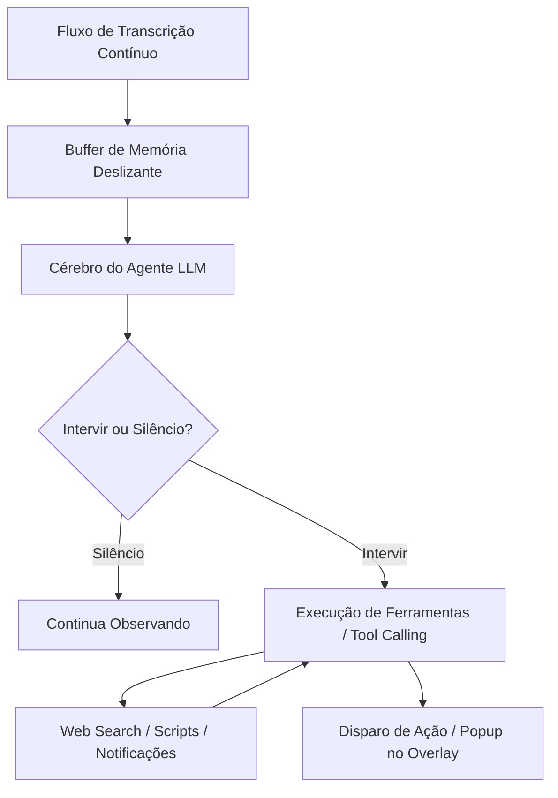
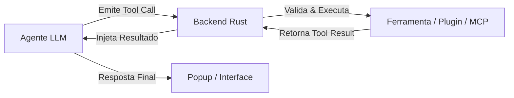

---
tags:
  - projeto/whisper-agent
  - llm
  - ai
  - personas
  - api
---
# 🧠 4. Integração LLM e Personas

## 📌 Objetivo
O motor de inteligência não é apenas um chatbot passivo de perguntas e respostas: **ele opera como um Agente Autônomo de Contexto**. Ele escuta o fluxo contínuo de áudio, mantém memória recente, decide autonomamente **se e quando deve intervir** e tem a capacidade de invocar **ferramentas (Tools/Function Calling)** para executar ações no computador.

---

## 🔑 Sistema BYOK & Provedores Universais (Inclusive APIs Custom)
O app não fica preso a nenhum fornecedor específico. Ele implementa um cliente HTTP flexível baseado no padrão universal **OpenAI-Compatible API**, permitindo conectar qualquer modelo existente:

### Provedores Suportados:
1. **Provedores Oficiais:** OpenAI, Anthropic Claude, Google Gemini, Groq, DeepSeek.
2. **APIs Customizadas / Qualquer Endpoint (OpenAI-Compatible):**
   - **Local:** `Ollama` (`http://localhost:11434/v1`), `LM Studio` (`http://localhost:1234/v1`), `vLLM`, `LocalAI`.
   - **Roteadores e Nuvem:** `OpenRouter`, `Together AI`, servidores corporativos privados ou proxies internos.
3. **Campos Configuráveis por Provedor Customizado:**
   - `Base URL:` Endpoint customizado (ex: `http://localhost:11434/v1` ou `https://meu-servidor-ai.com/v1`).
   - `API Key:` Chave de autenticação (opcional para modelos locais como Ollama).
   - `Model ID:` Nome livre do modelo (ex: `deepseek-chat`, `qwen2.5-coder:32b`, `llama-3.3-70b`).
   - `Custom Headers (Opcional):` Headers HTTP adicionais em formato JSON para autenticações especiais.
   - `Suporte a Tool Calling:` Checkbox para indicar se o modelo customizado suporta invocação de ferramentas (Function Calling) ou se deve operar apenas em modo texto puro.

---

## 🤖 1. Arquitetura do Agente



### A. Critério de Intervenção (Gating / Proatividade)
O agente não responde a cada frase solta (o que seria insuportável enquanto você joga ou estuda). Ele avalia o fluxo de áudio baseado nas regras da Persona:
- **Modo Silencioso/Proativo:** Intervém apenas quando detecta uma dúvida factual, erro evidente, pedido explícito de ajuda ou evento crítico.
- **Modo Chamada Direta (Hotword / Trigger):** Intervém quando você diz uma palavra de ativação (ex: *"Copiloto, ..."*, *"Whisper, ..."*) ou pressiona um atalho global (Push-to-Ask).

### B. Buffer de Contexto & Memória Deslizante
- **Detalhes Completos:** [[5. Otimizacao de Memoria e Contexto]]
- Implementação nativa em Rust inspirada nas arquiteturas do Mem0/Zep.
- Divide a memória em **Hot Ring Buffer (RAM)** para os últimos 60 segundos e **Rolling Summaries (SQLite)** para o contexto histórico da sessão.
- Garante retenção de contexto sem sobrecarregar a janela de tokens nem aumentar a latência.

---

## 🛠️ 2. Motor de Tool Calling Dinâmico & Extensível

Para permitir que o Agente invoque **qualquer ferramenta** de forma fluida, o sistema adota uma arquitetura em 4 pilares:

### A. Registro Dinâmico de Ferramentas (Tool Registry)
Cada ferramenta no sistema é registrada através de um manifesto padrão (JSON Schema):
- **Ferramentas Nativas (Built-in):**
  1. `show_overlay_popup(message, style, duration)`: Renderiza no [[2. Interface e Overlay]].
  2. `web_search(query)`: Busca fatos e documentação ao vivo no Google/DuckDuckGo.
  3. `clipboard_write(text)`: Copia código, links ou texto para a área de transferência.
  4. `system_notify(title, body)`: Emite notificação do SO.
  5. `execute_script(command, args)`: Roda comandos locais.
- **Ferramentas Customizadas do Usuário (User Plugins / MCP):**
  - O usuário pode criar novas ferramentas adicionando um pequeno manifesto JSON em uma pasta `plugins/` (ou configurando na UI de Settings).
  - Suporte ao protocolo **MCP (Model Context Protocol)**: Permite conectar servidores de ferramentas já existentes da comunidade com 1 clique (ex: GitHub MCP, Postgres MCP, Weather MCP).

### B. Invocador Universal (Dual-Mode Invoker)
Nem todo modelo (especialmente modelos locais menores no Ollama) possui suporte nativo a Function Calling da OpenAI. Por isso, implementamos dois modos automáticos:
1. **Modo Nativo (Structured JSON Calling):** Usado quando o provedor/modelo suporta `tools` na API (OpenAI, Anthropic, Gemini, Groq, Llama 3.3). Envia as definições em JSON Schema diretamente no payload.
2. **Modo Fallback / Prompt-Based (ReAct / XML Parser):** Usado em modelos customizados ou sem suporte nativo. O Rust injeta a documentação das ferramentas no System Prompt e instrui o modelo a responder com tags especiais:
   ```xml
   <tool_call>
   {"name": "web_search", "parameters": {"query": "Patch notes 9.0 Valorant"}}
   </tool_call>
   ```
   O backend em Rust intercepta essa tag no streaming, pausa a geração, executa a ferramenta e devolve o resultado para o modelo continuar falando.

### C. Ciclo de Execução com Retorno (Loop de Ferramentas)


### D. Segurança e Aprovação (Human-in-the-Loop)
Para evitar que o agente (ou modelos locais alucinando) execute scripts perigosos ou envie dados indesejados:
- **Níveis de Aprovação por Ferramenta (Requires Confirmation):** O *Tool Registry* suporta uma configuração por ferramenta que dita o nível de autonomia do agente:
  1. **Autoaprovação (Auto-Approval):** A ferramenta roda em background imediatamente (ideal para buscar na web, gerar popups, notificações).
  2. **Aprovação Manual (Manual Approval):** A ferramenta pausa o fluxo e pisca uma notificação no Overlay com botões "Aprovar" / "Negar" antes da execução final (mandatório para rodar scripts locais, modificar arquivos no SO, enviar requisições destrutivas POST/DELETE).
- **Escopo por Persona:** Diferentes personas podem ter conjuntos de ferramentas habilitadas distintos.

## 🎭 3. Personas como Agentes Especialistas
Cada Persona passa a ser a definição de um **Agente Especialista**:
- `ID / Nome:` "Fact-Checker em Tempo Real", "Tático de Valorant", "Pair Programmer".
- `System Prompt (Missão e Limites):` Diretrizes do agente (ex: *"Aja como um oráculo silencioso. Se o usuário afirmar algo incorreto em uma reunião/conversa, pesquise na web silenciosamente e mostre uma correção concisa via popup"*).
- `Ferramentas Habilitadas:` Escolha de quais ferramentas esse agente tem permissão de usar (ex: apenas popup e web search).
- `Sensibilidade de Intervenção:` Nível de proatividade (Alta, Média, Baixa ou Sob Demanda).

---

## 🔗 Links Relacionados
- [[1. Visao Geral e Arquitetura]]
- [[2. Interface e Overlay]]
- [[3. Motor STT Local e Audio]]
- [[5. Otimizacao de Memoria e Contexto]]
