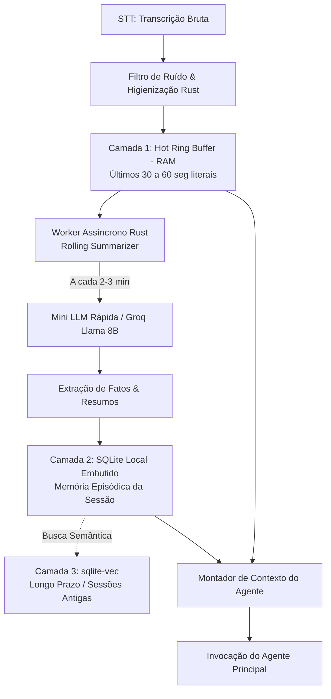

---
tags:
  - projeto/whisper-agent
  - memoria
  - rust
  - sqlite
  - llm
  - context-window
---
# 🧠 5. Otimização de Memória e Contexto em Tempo Real

## 📌 Objetivo
Manter o contexto amplo e a inteligência do agente durante horas de uso contínuo (partidas de jogos, reuniões, sessões de estudo) sem estourar o limite de tokens das LLMs, sem gerar custos excessivos e garantindo latência quase instantânea (<500ms).

---

## 🏗️ Decisão de Arquitetura: Motor Nativo em Rust + SQLite
Inspirando-se nas melhores práticas de projetos consolidados como **Mem0** e **Zep**, implementamos o motor de memória **100% nativo dentro do Tauri (Rust)**, sem exigir que o usuário instale Python, Docker ou servidores locais pesados. 

O app permanece distribuído como um único executável autocontido (`.exe` / `.app`).

---

## 🔄 Arquitetura de Memória em 3 Camadas



### 1. Camada 1: Hot Ring Buffer (Memória de Trabalho em RAM)
- **Local:** Memória RAM do processo Rust.
- **Estrutura:** Fila circular deslizante (*Ring Buffer* / `VecDeque`).
- **Capacidade:** Armazena os últimos 30 a 60 segundos de fala literal com carimbos de tempo (timestamps).
- **Papel:** Oferece máxima fidelidade para o que você acabou de dizer (uma pergunta direta, uma reação de jogo imediata).

### 2. Camada 2: Rolling Summarization (Resumo Contínuo em Segundo Plano)
- **Como funciona:** O worker em Rust coleta os blocos que estão saindo do Ring Buffer e sintetiza as informações em tópicos essenciais (bullet points), descartando enrolação e salvando no SQLite embutido.
- **Configuração do Gatilho (Trigger Configurável pelo Usuário):**
  O usuário pode escolher nas configurações como essa camada deve ser disparada:
  1. **Gatilho Temporal (Intervalo de Tempo):** O resumo roda a cada $X$ minutos fixos (ex: a cada 2 ou 3 minutos), independentemente do ritmo da conversa.
  2. **Gatilho por Silêncio (VAD / Pausa Natural):** O resumo só roda quando o microfone detecta um silêncio contínuo de $Y$ segundos (ex: 2 a 3 segundos de pausa) após um bloco de fala. Ideal para capturar pensamentos completos sem cortar frases no meio.
  3. **Gatilho Híbrido:** Prioriza o silêncio, mas possui um limite máximo de segurança (se a conversa não parar em 4 minutos, resume para não estourar a memória).
- **Gerenciamento de API Key (Sem Chave Adicional):**
  - **Zero chaves extras:** O sistema utiliza a **mesma chave de API** cadastrada para o agente principal, acionando o modelo leve daquele mesmo provedor (ex: `llama-3.1-8b` no Groq, `gpt-4o-mini` na OpenAI, `gemini-flash-lite` no Google).
  - **Modo Offline/Local (Opcional):** Permite também usar um modelo local ultraleve (ex: Llama-3.2-1B) para custo zero de tokens.

### 3. Camada 3: SQLite Embutido (Memória Histórica e Durabilidade)
- **Banco de Dados:** SQLite nativo via crate `rusqlite` (zero configuração para o usuário).
- **Tabelas Principais:**
  - `sessions`: Guarda o ID, data e persona ativa.
  - `events_summary`: Fatos e tópicos consolidados da sessão atual.
  - `user_facts`: Preferências e dados recorrentes aprendidos sobre o usuário (estilo Mem0).
- **Busca Semântica Opcional:** Utilização da extensão `sqlite-vec` para permitir que o agente faça RAG rápido se o usuário perguntar algo de 2 horas atrás.

---

## 🧩 Montagem Dinâmica do Contexto (Prompt Injection)
Quando o Agente ([[4. Integracao LLM e Personas]]) é acionado, o backend em Rust não envia gigabytes de texto cru. Ele monta um prompt enxuto e estruturado:

```markdown
[PERSONA ACTIVE]: Treinador Tático
[CONTEXTO CONSOLIDADO DA PARTIDA (Últimos 20 min)]:
- O time perdeu os rounds econômicos na defesa do Bomb A.
- O jogador principal está jogando de Sova e sem ultimate.
- Última rotação inimiga foi rápida pelo meio.

[ÚLTIMOS 45 SEGUNDOS (FALA AO VIVO)]:
"Onde eles estão armando agora? Ouvi barulho no B."
```

**Resultado:**
- Redução de até **85% no consumo de tokens**.
- Tempo de resposta da IA cai para frações de segundo.
- O agente nunca esquece o que aconteceu há 40 minutos atrás, mas não se afoga em detalhes irrelevantes.

---

## 🔗 Links Relacionados
- [[1. Visao Geral e Arquitetura]]
- [[2. Interface e Overlay]]
- [[3. Motor STT Local e Audio]]
- [[4. Integracao LLM e Personas]]
