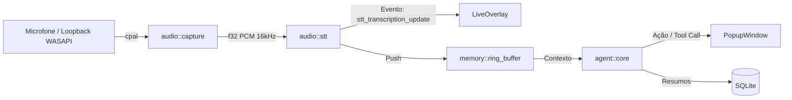

---
tags:
  - projeto/whisper-agent
  - arquitetura
  - harness
  - documentacao
---

# 🌐 Panorama do Projeto & Test Harness: WisperAgent

Este documento consolida a visão 360° da arquitetura, o estado atual de implementação e o **harness de testes e execução** do projeto no ecossistema **Obsidian Vault**.

---

## 🧭 Visão Geral & Proposta de Valor

O **WisperAgent** é um copiloto de IA em tempo real com overlay invisível (anti-capture), operando com transcrição de áudio 100% local (via Whisper/C++ embutido) e integração com LLMs em modo BYOK (Bring Your Own Key) ou endpoints locais (Ollama, LM Studio, etc.).

### Pilares Arquiteturais:
1. **Frontend UI (React 19 + TypeScript + Vite + Tailwind):**
   - Roteamento multi-janela dinâmico via `window.location.search` (`useAppRouter`):
     - `LiveOverlay`: visualização de legendas/transcrição ao vivo na tela.
     - `SettingsWindow`: setup de chaves, seleção de personas, microfones e modelos.
     - `PopupWindow`: balões flutuantes para intervenções agênticas e confirmação Humana (Human-in-the-Loop).
   - Sistema de temas sincronizado entre janelas via eventos de IPC Tauri (`whisper-theme-changed`).

2. **Backend Nativo (Rust + Tauri v2):**
   - **Áudio (`audio/`):** captura com `cpal` (WASAPI no Windows), hot-swapping de dispositivos e motor STT local `whisper-rs`.
   - **Agente & LLM (`agent/`):** client HTTP assíncrono (`reqwest`) com streaming SSE, dual-mode invoker (OpenAI function calling nativo + fallback de ReAct via XML).
   - **Memória (`memory/`):** Hot ring buffer em RAM (últimos 60s) e histórico persistente com SQLite (`rusqlite`) para rolling summarization.

---

## 🗂️ Mapeamento de Especificações & Documentos (Obsidian)

- [[1. Visao Geral e Arquitetura]]
- [[2. Interface e Overlay]]
- [[3. Motor STT Local e Audio]]
- [[4. Integracao LLM e Personas]]
- [[5. Otimizacao de Memoria e Contexto]]
- [[Specs/0. Index de Specs]]
- [[Specs/0. Roadmap de Implementacao]]

---

## 🧪 Project Harness (Execução, Compilação e Testes)

O WisperAgent possui requisitos específicos no ecossistema Windows devido à compilação de bindings C/C++ nativos do `whisper-rs` (`libclang`, `cmake`, MSVC).

### 1. Dependências do Ambiente
- **Node.js** e **npm** (para o frontend React/Vite)
- **Rust toolchain** (`cargo`, `rustc`)
- **Visual Studio 2022 Build Tools** (`vcvars64.bat`)
- **LLVM / Clang** (`LIBCLANG_PATH=C:\Program Files\LLVM\bin`)
- **CMake** (`C:\Program Files\CMake\bin`)

### 2. Scripts de Build e Execução

| Ação | Comando / Caminho | Descrição |
| :--- | :--- | :--- |
| **Checar Frontend** | `cd app && npm run build` | Compila TypeScript e gera bundle Vite no `dist/` (validado com sucesso). |
| **Modo Dev Frontend** | `cd app && npm run dev` | Inicia o servidor Vite na porta 1420. |
| **Compilar Rust/Backend** | `app/src-tauri/build_agent.bat` | Configura ambiente MSVC/Clang e executa `cargo build`. |
| **Executar com Tauri** | `cd app && npm run tauri dev` | Inicia ciclo completo de desenvolvimento com hot-reload. |

---

## 🔄 Fluxo de Dados (Pipeline IPC)

---

## 📌 Status Atual & Próximos Passos
- **Fase 1 (Fundação & Tray):** Concluída.
- **Fase 2 (Captura de Áudio & STT):** Implementado o pipeline `cpal` e bindings de STT.
- **Fase 3 (Frontend & Overlays):** Roteador dinâmico, Overlay, Settings e Popup implementados e validados no build.
- **Fase 4 & 5 (Agente & Memória):** Módulos estruturados, prontos para expansão e testes integrados ponta a ponta com hardware de áudio.
