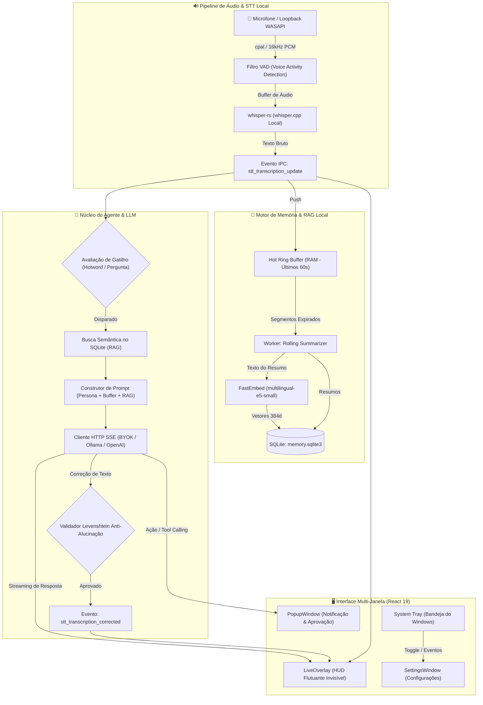

# 🎙️ WhisperAgent - AI Copilot em Tempo Real

<p align="center">
  <strong>Copiloto de IA para desktop com overlay invisível (anti-capture), transcrição de áudio 100% local e privada (Whisper C++) e arquitetura de memória contínua com RAG local.</strong>
</p>

<p align="center">
  
  
  
  
  
  
  
</p>

---

## 📑 Sumário

- [Visão Geral](#-visão-geral)
- [Funcionalidades Principais](#-funcionalidades-principais)
- [Arquitetura e Fluxo de Dados](#-arquitetura-e-fluxo-de-dados)
- [Camadas do Sistema](#-camadas-do-sistema)
  - [1. Motor de Áudio e STT Local](#1-motor-de-áudio-e-stt-local-audiostt)
  - [2. Sistema de Memória Híbrida e RAG Local](#2-sistema-de-memória-híbrida-e-rag-local-memory)
  - [3. Núcleo Agêntico, BYOK e Personas](#3-núcleo-agêntico-byok-e-personas-agent)
  - [4. Frontend Multi-Janela e Overlay](#4-frontend-multi-janela-e-overlay-ui)
- [Estrutura do Repositório](#-estrutura-do-repositório)
- [Requisitos de Ambiente](#-requisitos-de-ambiente)
- [Instalação e Execução](#-instalação-e-execução)
  - [1. Modo Desenvolvimento](#1-modo-desenvolvimento)
  - [2. Compilar e Gerar Instalador (.exe)](#2-compilar-e-gerar-instalador-exe)
- [Guia de Configuração e Uso](#-guia-de-configuração-e-uso)
- [Privacidade e Segurança](#-privacidade-e-segurança)
- [Especificações Técnicas (SDD)](#-especificações-técnicas-sdd)

---

## 🧭 Visão Geral

O **WhisperAgent** é um assistente contextual inteligente de última geração para Windows. Ele escuta continuamente o áudio do usuário (microfone) ou do próprio computador (loopback de chamadas, vídeos, reuniões), realiza **transcrição de voz em texto 100% offline e local** sem gastar APIs de terceiros e sem expor sua voz, e utiliza modelos de linguagem (LLMs locais ou em nuvem no modo BYOK) para gerar respostas instantâneas, insights e sugestões através de uma interface flutuante não invasiva.

Além disso, foi projetado com tecnologia **Anti-Capture**, garantindo que as janelas de overlay e legendas permaneçam visíveis para você, mas completamente invisíveis para softwares de gravação ou compartilhamento de tela como **OBS Studio, Discord, Zoom e Google Meet**.

---

## ⚡ Funcionalidades Principais

- 🔒 **Transcrição de Voz 100% Local (Zero Custos & Privacidade Máxima):**
  - Integração nativa com `whisper-rs` (`whisper.cpp` em C++ com aceleração CUDA/CPU).
  - Suporte aos modelos GGML (`tiny`, `tiny-q5_1`, `base`, `base-q5_1`), com download automático sob demanda no primeiro uso.
  - Zero envio de áudio para servidores externos.
- 👻 **Overlay Invisível Anti-Capture:**
  - Janela HUD sem bordas, transparente, reposicionável e com opção de *click-through*.
  - Ativação nativa da API do Windows `SetWindowDisplayAffinity(WDA_EXCLUDEFROMCAPTURE)`. Você enxerga as informações na tela, mas ninguém na transmissão/gravação consegue ver.
- 🧠 **Memória Híbrida em 3 Camadas:**
  - **Hot Ring Buffer (RAM):** Retém os últimos 60 segundos de fala literal verbatim para intervenções imediatas e contexto ultrarrápido.
  - **Rolling Summarizer (Thread de Fundo):** Condensa periodicamente os blocos de transcrição expirados em resumos progressivos no SQLite (`memory.sqlite3`).
  - **Local RAG (FastEmbed + SQLite):** Geração de embeddings semânticos com `multilingual-e5-small` diretamente na máquina para busca vetorial por similaridade de cosseno de conversas passadas.
- ✨ **Refinamento Gramatical & Validador Anti-Alucinação:**
  - O WhisperAgent possui um pipeline opcional onde o LLM corrige pontuação, concordância e acentos da transcrição bruta.
  - Um algoritmo interno rigoroso baseado em distância de edição Levenshtein e proporção de vocabulário impede que o modelo alucine respostas explicativas no lugar de uma simples correção de texto.
- 🔑 **Bring Your Own Key (BYOK) & Provedores Customizáveis:**
  - Conecte-se a qualquer provedor compatível com o padrão OpenAI: **OpenAI, Anthropic Claude, Google Gemini, Groq, DeepSeek, OpenRouter**, ou servidores locais como **Ollama, LM Studio e vLLM**.
- 🎭 **Personas Configuráveis e Gatilhos Dinâmicos:**
  - Crie personas para cada momento: "Assistente Conciso", "Revisor Técnico", "Tático de Reuniões", etc.
  - Modos de disparo:
    - **Hotword:** Ativa o agente apenas quando uma palavra-chave é dita (ex: *"copiloto"*).
    - **Question Only:** Dispara apenas quando uma pergunta direta for detectada.
    - **Contínuo:** Responde de forma assistida com base em limites de caracteres acumulados.
- 🪟 **Interface Multi-Janela React 19 + Tauri v2:**
  - **LiveOverlay:** Exibição elegante de legendas em tempo real e respostas com suporte completo a Markdown (código, tabelas, destaques).
  - **SettingsWindow:** Central de configuração de áudio (sensibilidade VAD, seleção de dispositivo), chaves de API, temas e personas.
  - **PopupWindow:** Balões contextuais no canto da tela para aprovação de ferramentas (*Human-in-the-Loop*) e notificações inteligentes.
  - **System Tray:** Integração nativa à barra de tarefas do Windows para alternar visibilidade ou acessar preferências a qualquer momento.

---

## 🔄 Arquitetura e Fluxo de Dados

O diagrama abaixo ilustra o ciclo de vida da informação, desde a captura analógica do microfone até a exibição contextualizada no overlay:



---

## 🧩 Camadas do Sistema

### 1. Motor de Áudio e STT Local (`audio/`)
- **`capture.rs`**: Gerencia fluxos de entrada de áudio via `cpal` (WASAPI no Windows). Suporta troca a quente (*hot-swapping*) de dispositivos de gravação e detecção de atividade de voz (VAD) para evitar consumo desnecessário de CPU em silêncio.
- **`stt.rs`**: Encapsula o motor `whisper-rs`. Realiza inferência em blocos de PCM 16kHz normalizados em `f32`, emitindo as transcrições parciais e finais em tempo real para o frontend via eventos do Tauri.
- **`setup.rs`**: Responsável pelo download e verificação de integridade dos modelos Whisper GGML (`tiny`, `base`, versões quantizadas `q5_1`).

### 2. Sistema de Memória Híbrida e RAG Local (`memory/`)
- **`ring_buffer.rs`**: Buffer circular em memória RAM que retém os dados mais recentes (padrão de 60 segundos), garantindo latência zero para consultas imediatas do agente.
- **`db.rs` & `session.rs`**: Gerenciamento de persistência local via `rusqlite` em modo WAL (*Write-Ahead Logging*). Armazena sessões, transcrições brutas, resumos e vetores.
- **`summarizer.rs`**: Processo em background que consome os blocos de áudio que saem do Ring Buffer e gera resumos periódicos compactos para manter o histórico utilizável sem estourar o limite de tokens da LLM.
- **`rag.rs`**: Motor de busca semântica embutido utilizando o modelo `multilingual-e5-small` da biblioteca `fastembed`. Gera vetores de 384 dimensões e realiza buscas por similaridade de cosseno diretamente no banco SQLite, 100% offline.

### 3. Núcleo Agêntico, BYOK e Personas (`agent/`)
- **`core.rs`**: Orquestra o ciclo cognitivo. Recebe a fala transcrita, avalia se as condições da Persona ativa foram satisfeitas, monta o contexto (Persona + Hot Buffer + RAG) e invoca a LLM. Também contém o algoritmo de validação e fidelidade lexical contra alucinações.
- **`llm_client.rs`**: Cliente HTTP assíncrono sobre `reqwest` com streaming via SSE (*Server-Sent Events*), compatível com qualquer endpoint com formato OpenAI.
- **`tool_registry.rs`**: Gerencia ferramentas executáveis pelo modelo e intermediador de aprovações humanas (*Human-in-the-Loop*).

### 4. Frontend Multi-Janela e Overlay (`ui/`)
- Construído com **React 19**, **TypeScript**, **Vite** e **Tailwind CSS**.
- **Roteador Dinâmico (`useAppRouter`)**: Permite que uma única build do Vite alimente múltiplas janelas isoladas do Tauri (`overlay`, `main`, `popup`) com alta performance e semântica limpa.
- **Sincronização de Temas em Tempo Real**: Altera esquemas de cores e transparências em todas as janelas abertas simultaneamente através de canais de eventos IPC nativos.
- **Renderização de Markdown**: Suporte em tempo real a blocos de código com destaque, tabelas e listas nas respostas do copiloto.

---

## 📁 Estrutura do Repositório

```text
WhisperAgent/
├── 1. Visao Geral e Arquitetura.md        # Documentação conceitual do projeto
├── 2. Interface e Overlay.md              # Documentação das janelas e anti-capture
├── 3. Motor STT Local e Audio.md          # Especificações de áudio e whisper.cpp
├── 4. Integracao LLM e Personas.md        # Especificações do agente e BYOK
├── 5. Otimizacao de Memoria e Contexto.md # Especificações da memória e RAG
├── 6. Panorama do Projeto e Harness.md    # Harness de testes e visão 360°
├── Specs/                                 # Especificações técnicas estritas (SDD)
│   ├── 0. Index de Specs.md
│   ├── Spec_Audio_Capture.md
│   ├── Spec_Whisper_Engine.md
│   ├── Spec_LLM_Client_BYOK.md
│   ├── Spec_Live_Overlay.md
│   ├── Spec_Popup_System.md
│   └── Spec_DB_Schema.md
├── build_installer.bat                    # Script para compilação do instalador NSIS
└── app/                                   # Código-fonte da aplicação (Tauri + React)
    ├── package.json                       # Dependências do frontend
    ├── vite.config.ts                     # Configuração do bundler Vite
    ├── src/                               # Frontend (React 19 + TypeScript)
    │   ├── App.tsx                        # Ponto de entrada do frontend
    │   ├── components/
    │   │   ├── LiveOverlay.tsx            # Janela de legendas e HUD flutuante
    │   │   ├── SettingsWindow.tsx         # Janela de configurações completa
    │   │   ├── PopupWindow.tsx            # Balão flutuante de ações / aprovações
    │   │   └── MarkdownViewer.tsx         # Renderizador de Markdown
    │   ├── hooks/                         # Hooks de roteamento e integração
    │   └── utils/                         # Utilitários de tema e persistência
    └── src-tauri/                         # Backend Nativo (Rust + Tauri v2)
        ├── Cargo.toml                     # Crates e dependências Rust
        ├── tauri.conf.json                # Configuração de janelas e permissões Tauri
        ├── build_agent.bat                # Auxiliar de compilação MSVC
        └── src/
            ├── main.rs                    # Entrypoint da aplicação
            ├── lib.rs                     # Setup do Tauri, Tray, rotas e workers
            ├── audio/                     # Captura WASAPI e motor Whisper STT
            ├── memory/                    # Ring Buffer, SQLite, Summarizer e RAG
            └── agent/                     # Core agêntico, cliente BYOK e Personas
```

---

## 💻 Requisitos de Ambiente

Para compilar e executar o projeto a partir do código-fonte no Windows:

1. **Node.js**: Versão 18 ou superior (com `npm`).
2. **Rust**: Versão estável instalada via `rustup` (`cargo`, `rustc`).
3. **Visual Studio 2022 Build Tools**: Com a carga de trabalho de desenvolvimento para C++ instalada (necessário para compilar dependências nativas e gerar os binários MSVC x64).
4. **LLVM / Clang**: Necessário para os bindings de C++ do `whisper-rs`.
   - Definir a variável de ambiente: `LIBCLANG_PATH=C:\Program Files\LLVM\bin`
5. **CMake**: Versão 3.20 ou superior no `PATH` do sistema.

---

## 🚀 Instalação e Execução

### 1. Modo Desenvolvimento

1. **Clone o repositório:**
   ```bash
   git clone https://github.com/gunsleobezerra/WhisperAgent_v1.git
   cd WhisperAgent
   ```

2. **Instale as dependências do Frontend:**
   ```bash
   cd app
   npm install
   ```

3. **Inicie o ambiente de desenvolvimento:**
   ```bash
   npm run tauri dev
   ```
   > O Tauri compilará o core em Rust e iniciará o servidor Vite com hot-reload. O ícone da aplicação surgirá na bandeja do sistema (System Tray) e o overlay aparecerá no canto superior da tela.

---

### 2. Compilar e Gerar Instalador (.exe)

Você pode compilar o binário otimizado e gerar o instalador do Windows executando o script automatizado na raiz do projeto:

```cmd
build_installer.bat
```

Ou diretamente via comando `tauri`:
```bash
cd app
npm run tauri build
```

O instalador gerado estará localizado em:
```text
app/src-tauri/target/release/bundle/nsis/WhisperAgent_0.1.0_x64-setup.exe
```

---

## ⚙️ Guia de Configuração e Uso

1. **Acessando as Configurações:**
   - Dê um clique duplo ou clique com o botão direito no ícone do **WhisperAgent** na **Bandeja do Sistema (System Tray)** e selecione **Configurações**.
2. **Configuração de Áudio:**
   - Selecione o dispositivo de microfone de entrada desejado.
   - Ajuste o limiar de sensibilidade do VAD para ignorar ruídos de respiração e teclado.
3. **Modelo de Transcrição (Whisper):**
   - No primeiro início, o modelo padrão (`ggml-base.bin` ou `ggml-tiny.bin`) será baixado automaticamente para `%LOCALAPPDATA%\WhisperAgent\models`.
4. **Configuração do Provedor de IA (BYOK):**
   - Insira sua **API Key** e a **Base URL** (para OpenAI, use a padrão; para Groq, DeepSeek, OpenRouter ou Ollama local `http://localhost:11434/v1`, insira o endereço correspondente).
   - Teste a conexão diretamente pelo botão na tela de configurações.
5. **Criando ou Editando Personas:**
   - Escolha o comportamento desejado para a IA (ex: assistente de código, tradutor simultâneo, resumidor de reuniões).
   - Configure a **Hotword** (palavra de ativação) ou selecione o modo **Question Only**.

---

## 🛡️ Privacidade e Segurança

- **Áudio Imune a Vazamentos:** O áudio capturado é processado exclusivamente na memória RAM da sua máquina pelo motor Whisper compilado localmente. Em nenhum momento pacotes de áudio brutos são enviados para a nuvem.
- **Anti-Screen Capture:** A proteção contra captura de tela é ativada no nível do sistema operacional via `SetWindowDisplayAffinity(WDA_EXCLUDEFROMCAPTURE)`. Transmissões de jogos, aulas ou apresentações de trabalho nunca exibirão suas anotações ou respostas do copiloto.
- **Chaves de API Locais:** Suas chaves de API e histórico de conversas residem no seu próprio disco (`%LOCALAPPDATA%\WhisperAgent\memory.sqlite3`).

---

## 📐 Especificações Técnicas (SDD)

O desenvolvimento deste software segue a metodologia **Spec-Driven Development (SDD)**. Cada componente possui uma especificação técnica formal e imutável documentada no diretório [`Specs/`](file:///Specs):

- [Índice de Especificações](file:///Specs/0.%20Index%20de%20Specs.md)
- [Captura de Áudio e Streaming](file:///Specs/Spec_Audio_Capture.md)
- [Motor Whisper e Modelos](file:///Specs/Spec_Whisper_Engine.md)
- [Cliente LLM e BYOK](file:///Specs/Spec_LLM_Client_BYOK.md)
- [Hot Ring Buffer](file:///Specs/Spec_Ring_Buffer.md)
- [Schema de Banco e RAG](file:///Specs/Spec_DB_Schema.md)
- [Sistema de Popups](file:///Specs/Spec_Popup_System.md)

---

<p align="center">
  Desenvolvido por <strong>Leonardo Bezerra</strong>
</p>
